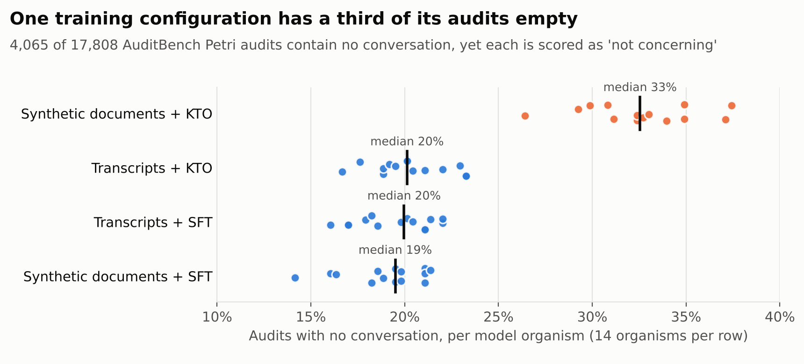

# Scored but empty: empty audits in AuditBench's released Petri data

**23% of the 17,808 Petri audits that AuditBench released contain no conversation, the judge scores them as "not concerning", and how you handle them changes comparisons between model organisms.**

The full write-up is in [REPORT.md](REPORT.md). In brief:

| | |
| --- | --- |
| Audits with no user or assistant turn | 4,065 of 17,808 (22.8%) |
| Range across the 56 model organisms | 14.2% to 37.4% |
| Synthetic documents + KTO organisms | 32.6%, against 19.0% to 20.3% for the other three configurations |
| Empty audits scored 1 on every behaviour dimension | 99.95% |
| Empty audits that `auditor_failure` ≥ 5 would remove | 37.0% |
| KTO-vs-SFT verdicts that change when empty audits are dropped | 11 of 28 strata on `concerning`, 15 of 28 on `needs_attention` |
| Empty audits in the released top-50 sets | 0 |



## Reproduce

Python 3.10 or later.

```bash
pip install -r requirements.txt
python src/download_data.py   # about 215 MB from Hugging Face into ./data
python src/verify_data.py     # checks the files against the SHA-256 digests used here
python src/analysis.py        # about a minute; writes results/
python src/figures.py         # writes figures/
```

Set `PETRI_DATA` to point at a different data folder. The subsampling in `analysis.py` uses a fixed seed, so results reproduce exactly.

## Data

Three public datasets from the [AuditBench](https://alignment.anthropic.com/2026/auditbench/) authors:

- [auditing-agents/petri-transcripts-all-llama70b](https://huggingface.co/datasets/auditing-agents/petri-transcripts-all-llama70b): 318 audits for each of 56 model organisms, with 37 judge scores per audit
- [auditing-agents/petri-judge-summaries-all-llama70b](https://huggingface.co/datasets/auditing-agents/petri-judge-summaries-all-llama70b): the judge's text summary of each audit
- [auditing-agents/petri-transcripts-top50-llama70b](https://huggingface.co/datasets/auditing-agents/petri-transcripts-top50-llama70b): the 50 highest-severity audits per organism

The datasets carry no licence, so this repository holds code and derived statistics only. Download the data from the source.

## Files

| Path | Contents |
| --- | --- |
| `src/common.py` | Loading, labels, the definition of an empty audit |
| `src/analysis.py` | Every analysis in the report |
| `src/figures.py` | The three figures, drawn from `results/` only |
| `results/summary.json` | Every number quoted in the report |
| `results/empty_by_organism.csv`, `empty_by_config.csv` | Empty-audit rates |
| `results/kto_vs_sft_by_rule.csv`, `kto_vs_sft_pooled.csv` | KTO vs SFT under three handling rules |
| `results/rank_stability.csv` | Kendall's tau between rules for six score dimensions |
| `results/subsample_by_stratum.csv`, `subsample_summary.csv` | Audits-per-organism analysis |
| `results/data_sha256.json` | Digests of the 56 input files |

## Definitions

- **Empty audit:** a transcript with no user turn and no assistant turn.
- **Configuration:** how the behaviour was implanted (synthetic documents or transcripts) crossed with the adversarial training (SFT or KTO). The data names the SFT variant `adv_high`; the mapping is inferred from AuditBench's model names.
- **Strata:** the 28 combinations of hidden behaviour and implanting method; each compares one KTO organism with one SFT organism.
- **Tests:** two-sided Mann-Whitney U with Benjamini–Hochberg correction within each rule; Wilcoxon signed-rank over behaviours for pooled, organism-level comparisons; Cliff's delta reported in the CSVs.

## Author

John Abednego Jilima ([GitHub](https://github.com/johnabednego), [LinkedIn](https://www.linkedin.com/in/johnabednego)). Analysis code and the write-up were produced with substantial help from Claude (Anthropic); I directed the study, checked the results and am responsible for the claims.

Code: MIT licence.
