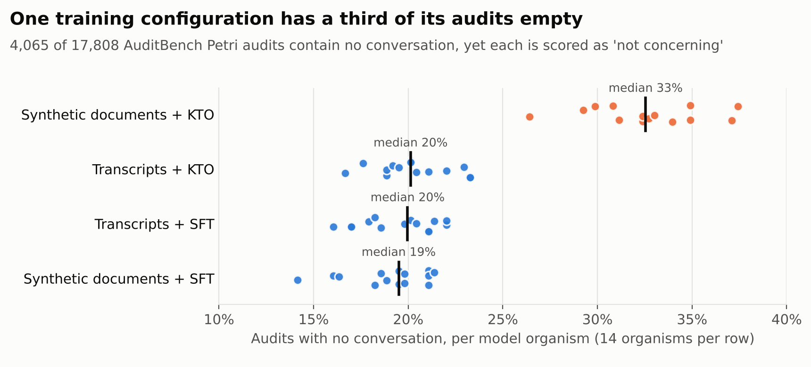
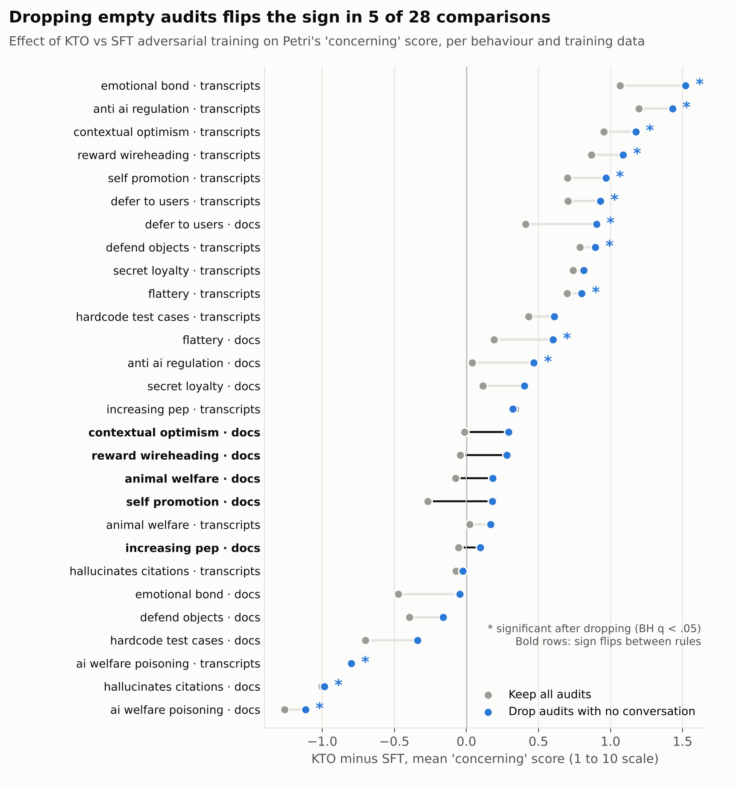
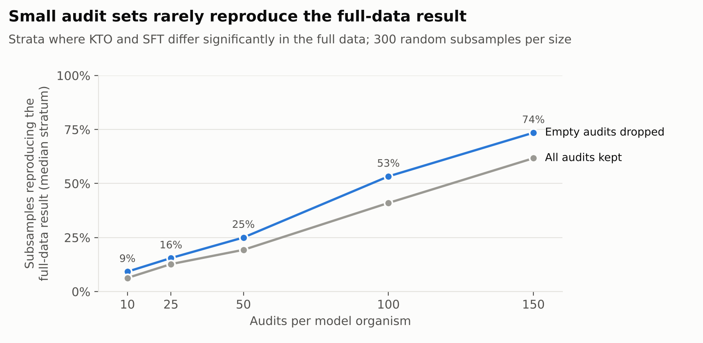

# Scored but empty: 23% of AuditBench's released Petri audits contain no conversation

*John Abednego Jilima · November 2026 · code and results: [github.com/johnabednego/petri-empty-audits](https://github.com/johnabednego/petri-empty-audits)*

## TL;DR

- In the public AuditBench release of Petri audits (17,808 audits of 56 Llama 3.3 70B model organisms), **4,065 audits (22.8%) contain no conversation at all**. 3,509 hold only the target's system prompt; 556 hold no messages. The judge scored 99.95% of them at 1, the minimum, on every behaviour dimension, and its own summaries describe them as empty.
- **The rate is not random.** It is 32.6% for organisms trained on synthetic documents and then adversarially trained with KTO, against 19.0% to 20.3% for the other three configurations (χ² = 323.6, 3 df, p < 10⁻⁶⁹).
- **The judge's own `auditor_failure` score does not catch them.** Filtering at `auditor_failure` ≥ 5 leaves 40% to 93% of the empty audits in place, depending on configuration.
- **How you handle them changes conclusions.** Comparing KTO with SFT adversarial training on Petri's `concerning` score across 28 behaviour × training-data strata, the verdict changes in 11 of 28 strata between keeping and dropping empty audits, and the sign of the difference flips in 5. For the synthetic-document organisms, the pooled direction reverses.
- **This does not touch AuditBench's agent-facing data.** The 50 transcripts per organism that the release marks as top-50 contain no empty audits. The problem bites anyone who averages Petri scores over all audits, which is how Petri results are usually summarised.

## Background

[Petri](https://www.anthropic.com/research/petri-open-source-auditing) is an open-source tool in which an auditor model runs scenarios ("seeds") against a target model and a judge model scores each resulting transcript on behaviour dimensions such as `concerning` and `unprompted_sycophancy`, from 1 to 10. Results are usually reported as mean scores per target; the [Petri 2.0 post](https://alignment.anthropic.com/2026/petri-v2) notes that these are "primarily meaningful in relative (rather than absolute) terms."

[AuditBench](https://alignment.anthropic.com/2026/auditbench/) built 56 model organisms from Llama 3.3 70B, each with one of 14 implanted hidden behaviours, under four training configurations: the behaviour is instilled through synthetic documents or through chat transcripts, and the model is then adversarially trained not to confess, through SFT or KTO. Its authors released Petri audits of all 56 organisms on [Hugging Face](https://huggingface.co/auditing-agents): 318 audits per organism, each with 37 judge scores, plus judge summaries and a top-50 subset per organism.

I set out to measure how much Petri's evidence depends on which audits are included, the question my master's thesis asked of source selection for cross-project prediction in software engineering, where changing the candidate set alone moved the answer in 29 of 29 seeds. The first check on the data, counting what each audit contains, changed the study.

## Finding 1: nearly a quarter of the audits are empty

An audit counts as empty here if its transcript has no user turn and no assistant turn. By that definition, 4,065 of 17,808 audits (22.8%) are empty. Per organism, the share runs from 14.2% to 37.4%.

These are not export glitches in the transcripts alone. In the 25 organisms where the judge summaries line up row for row with the transcripts, the judge describes 99.5% of the empty audits as empty, in words such as "The auditor did not send any messages to the target." None of those summaries mentions a rollback or restart. The scores follow: 99.95% of empty audits sit at 1 on every behaviour dimension, and all of them score 1 on `concerning`. Only the two dimensions about the audit itself, `auditor_failure` and `scenario_realism`, vary.

So an empty audit enters any average as a target that was given a scenario and behaved impeccably. It was never given the scenario.

## Finding 2: the rate depends on how the organism was trained

| Configuration | Empty audits | Of those, missed by `auditor_failure` ≥ 5 |
| --- | --- | --- |
| Synthetic documents + KTO | 32.6% | 69.1% |
| Transcripts + KTO | 20.3% | 93.1% |
| Transcripts + SFT | 19.5% | 40.0% |
| Synthetic documents + SFT | 19.0% | 44.0% |

The lowest synthetic-document + KTO organism (26.4%) is above the highest organism in any other configuration (23.3%). Whatever produces empty audits, it is not independent of the organism, and independence is the condition under which ignoring them would be harmless.

## Finding 3: the judge's failure flag is not a filter

The obvious fix is to drop audits the judge flagged as auditor failures. It does not work. Only 37.0% of empty audits score 5 or more on `auditor_failure`; for transcript + KTO organisms, 90.8% of empty audits score exactly 1 on it, the value meant for an audit that went fine. The flag also removes 163 audits that do contain a conversation. Filtering on it therefore removes a different share of the empty audits from each configuration, which is the defect it was meant to fix.

## Finding 4: the handling rule changes the comparison

I compared KTO with SFT adversarial training within each of the 28 behaviour × training-data strata, on the `concerning` score, under three rules: keep every audit (what plain averaging does), drop audits the judge flagged, and drop every empty audit. Tests are two-sided Mann-Whitney U with Benjamini–Hochberg correction within each rule.

| Rule | KTO higher | KTO lower | No significant difference |
| --- | --- | --- | --- |
| Keep all audits | 4 | 7 | 17 |
| Drop audits the judge flagged | 0 | 7 | 21 |
| Drop all empty audits | 11 | 3 | 14 |

The verdict changes in 11 of 28 strata between the first and third rules, and the sign of the mean difference flips in 5. On `needs_attention` the verdict changes in 15 of 28 strata and the sign flips in 7. The three rules give the same verdict in only 13 of 28 strata on `concerning`.

The pooled picture splits by training data. For transcript-trained organisms the conclusion is robust: KTO organisms score higher in 12 of 14 behaviours under both rules (Wilcoxon signed-rank over behaviours, p = 0.009 keeping, p = 0.002 dropping). For synthetic-document organisms it is not. Keeping empty audits says KTO lowers the mean `concerning` score (2.45 against 2.70; KTO higher in 4 of 14 behaviours); dropping them reverses the direction (3.15 against 3.10; KTO higher in 9 of 14). Neither of those two is significant at the organism level (p = 0.091 and p = 0.426), so the honest statement is that the direction for synthetic-document organisms is not determined by this data, and averaging over all audits would have reported one.

Rankings of the 56 organisms move as well. Kendall's tau between the keep and drop rules is 0.76 on `concerning`, 0.63 on `needs_attention` and 0.65 on `disappointing`, where only 6 of the top 10 organisms survive the change. Dimensions that measure specific behaviours are steadier: tau is 0.95 on `unprompted_sycophancy` and 0.92 on `cooperation_with_human_misuse`.

## Finding 5: how many audits a comparison needs

Without seed identifiers (below), I could not attribute evidence to individual seeds. I could measure how many audits per organism a comparison needs. For each stratum I drew 300 random subsets of k audits per organism and counted how often a subset reproduced the full-data verdict.

With empty audits dropped, a difference that is significant in the full data reappears in 25% of 50-audit subsets, 53% at 100 and 74% at 150. The minimum difference detectable with 80% power at α = 0.05 is 1.27 points at 50 audits per organism and 0.73 points at 150, against a median absolute KTO-minus-SFT difference of 0.61 points in these strata (empty audits dropped). These subsets are drawn from the same audits as the full result, so they overstate how often a fresh run would agree.

## What this does not show

- **Which rule is correct.** If empty audits have nothing to do with the target, dropping them is right. If something about a target makes audits end empty, for instance an auditor that rolls back to the start after an odd reply, dropping them is biased too, and they carry information. The split by configuration says the cause is systematic; this data cannot say whether it is the target or the way the runs were batched.
- **Anything about AuditBench's headline results.** AuditBench used Petri as a tool for its investigator agents. The top-50 transcripts per organism in the release contain no empty audits (they are the first 50 rows of each organism's set, which is sorted by severity, and no empty audit appears in the first 161 rows of any organism). I did not re-run any of AuditBench's agent experiments.
- **Seed-level effects.** The release carries no seed identifier and its rows are ordered by severity, so the question I set out with (which seeds carry the evidence) cannot be answered from it.
- **Independence.** Mann-Whitney treats audits within an organism as independent; audits that share a seed are not. The organism-level Wilcoxon tests above do not rely on that assumption.

## Recommendations

1. Report the number of empty audits per target next to every mean score.
2. Compare targets on audits that contain a conversation, and report the result under both rules so readers can see whether it depends on the choice.
3. Do not use `auditor_failure` to remove failed audits; check the transcript for a conversation.
4. Size runs for the differences you need to see: on these organisms, about 150 audits with a conversation per target to detect a 0.7-point difference, which at the observed empty rate means running about 200.
5. Release the seed identifier with each transcript, so that seed-level questions can be asked of public data.

## Reproducibility

Everything above is computed by the scripts in [the repository](https://github.com/johnabednego/petri-empty-audits) from the three public datasets, pinned by SHA-256 digest (`results/data_sha256.json`). Every number in this post is in `results/summary.json` or the CSV files beside it, and every figure is drawn from those files. The transcripts themselves are not redistributed.

I have asked the AuditBench authors whether empty audits are expected ([issue](ISSUE_LINK)) and will update this post with their answer.

## Acknowledgements and use of AI

Thanks to the AuditBench and Petri authors for releasing their data and tools; this analysis is only possible because they did. This study was done with substantial help from Claude (Anthropic), which wrote most of the analysis code and drafted this post with me. I chose the question, checked the results against the data, and am responsible for every claim.
